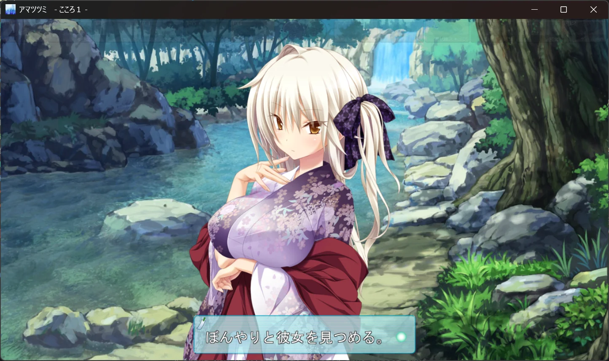
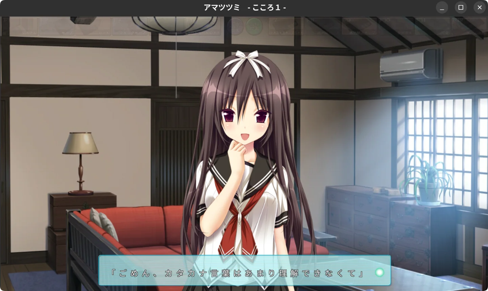
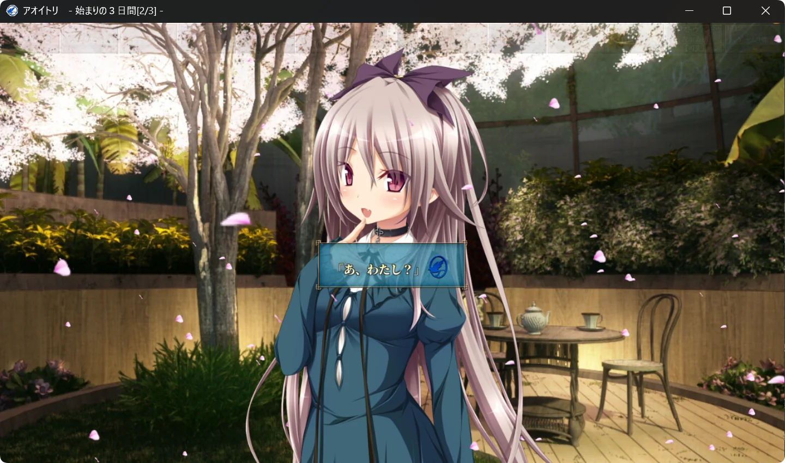
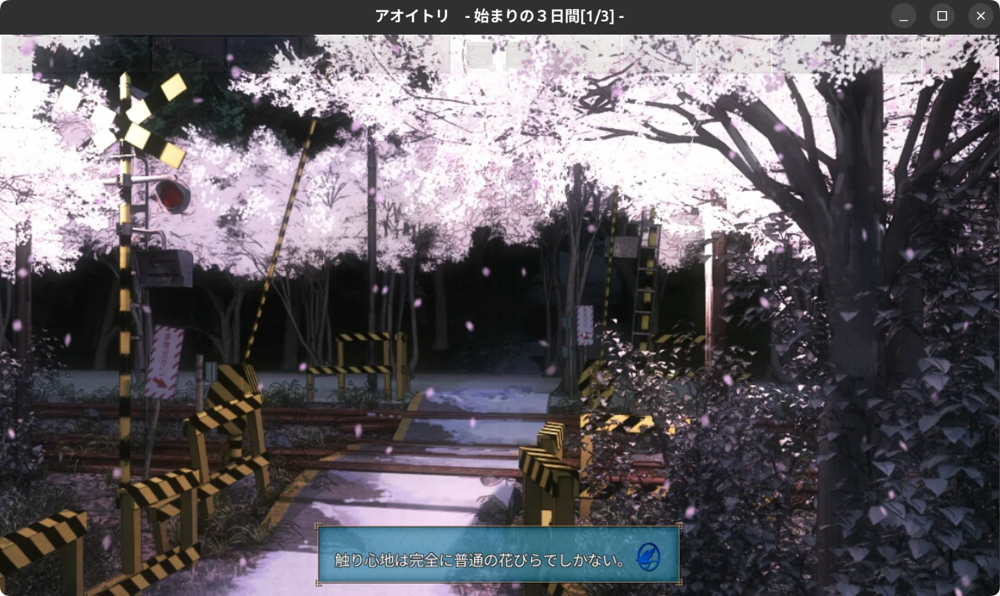

# cmvs-rs

[简体中文](README.md) | English

A **Rust** reimplementation of Purple SOFTWARE's CMVS engine.

## Demos

<table>
  <tr>
    <th colspan="3">Amatsutsumi</th>
  </tr>
  <tr>
    <td align="center" width="33%">
      
    </td>
    <td align="center" width="33%">
      
    </td>
    <td align="center" width="33%">
      
    </td>
  </tr>
  <tr>
    <td align="center"><strong>Windows</strong></td>
    <td align="center"><strong>Linux</strong></td>
    <td align="center"><strong>Android</strong></td>
  </tr>
  <tr>
    <th colspan="3">Aoitori</th>
  </tr>
  <tr>
    <td align="center" width="33%">
      
    </td>
    <td align="center" width="33%">
      
    </td>
    <td align="center" width="33%">
      
    </td>
  </tr>
  <tr>
    <td align="center"><strong>Windows</strong></td>
    <td align="center"><strong>Linux</strong></td>
    <td align="center"><strong>Android</strong></td>
  </tr>
</table>

## Getting Started

Requires **Rust 1.89+ stable**. The `--offline` flag requires dependencies to be cached locally.

```bash
cargo run --offline -- "<game-directory>/data/pack/start.ps3"
cargo test --offline
```

See the [Running Guide](docs/guides/running.md) for desktop previews, startup snapshot barriers, fonts, audio, and a separate user data directory. See the [CLI Guide](docs/guides/cli.md) for inspection tools.

## Current Status

See [Current Status](docs/status.md) for capabilities, game validation scope, and major gaps. All documented samples are listed in the [Game Archive](docs/games/README.md).

## Documentation and Development

- [Documentation Index and Archiving Rules](docs/README.md): find documentation by purpose.
- [Architecture](docs/architecture.md) and [Workspace](docs/workspace.md): module responsibilities, dependencies, and the full set of validation commands.
- [Research Guidelines](docs/research.md): evidence requirements and steps for adding support for a new game.
- [Engine Profiles](docs/design/engine-profiles.md): gates for selecting command semantics by engine build.
- [References and Licensing](docs/references.md): pinned commits, third-party dependencies, and reuse boundaries.

Before submitting changes, run:

```bash
cargo fmt --check
cargo test --offline
cargo clippy --offline --all-targets -- -D warnings
```

Tests contain only synthetic data. After changing decoding algorithms, also validate against real samples kept outside the repository and an independent Python implementation. For changes involving backends or features, run the additional all-features checks described in [Workspace](docs/workspace.md).

## License

[MIT](LICENSE-MIT) OR [Apache-2.0](LICENSE-APACHE)
