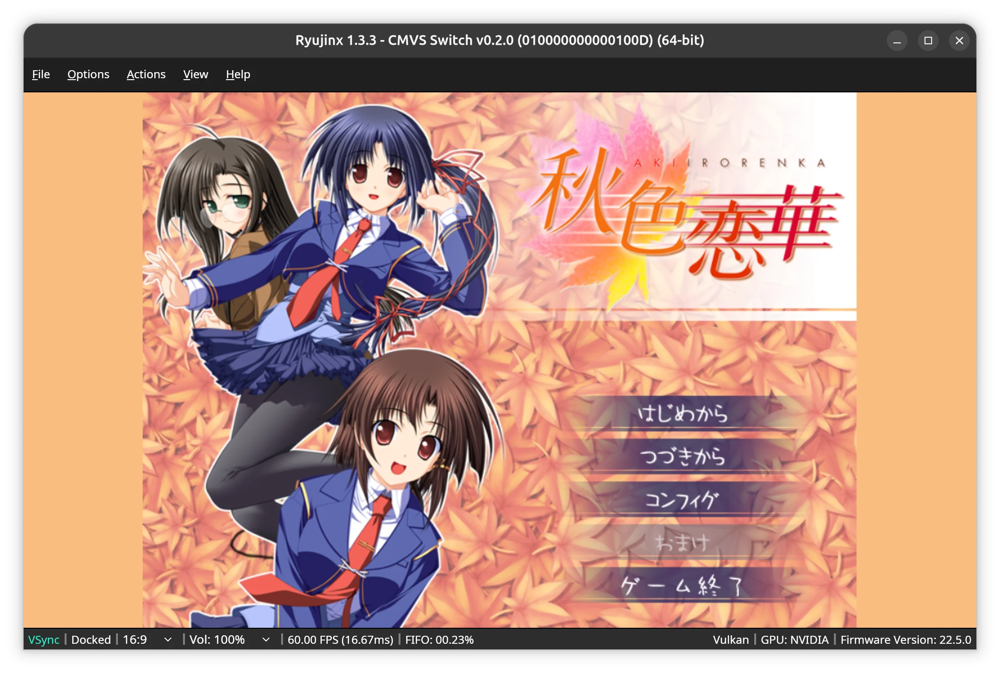
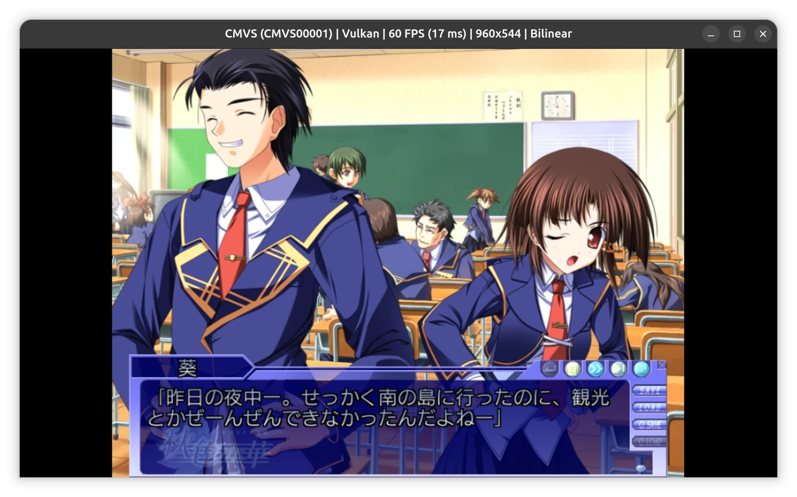
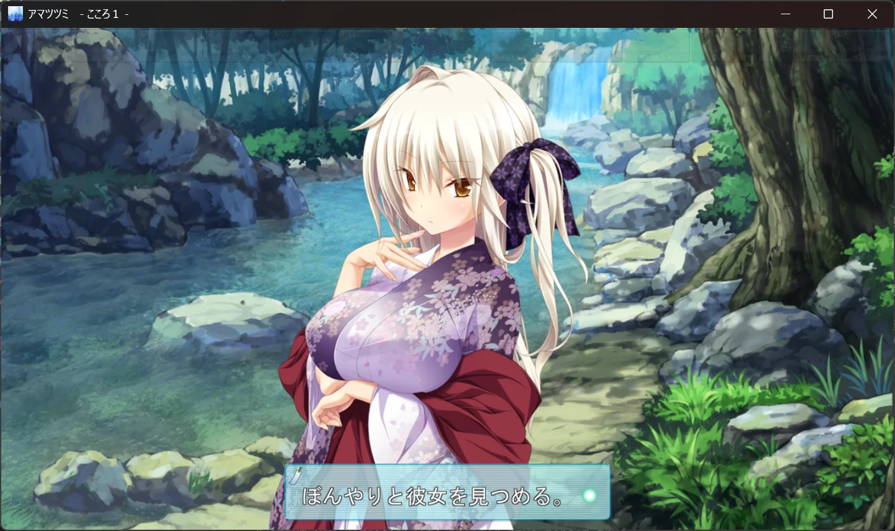
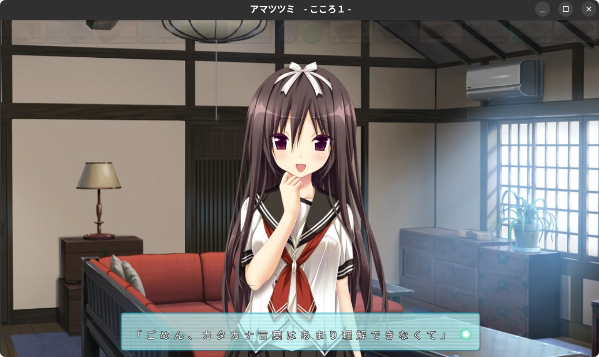
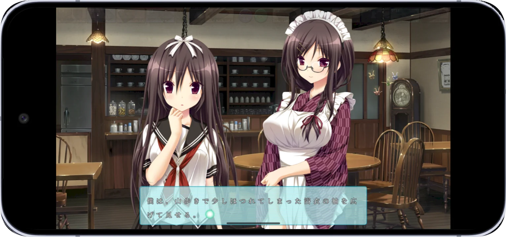
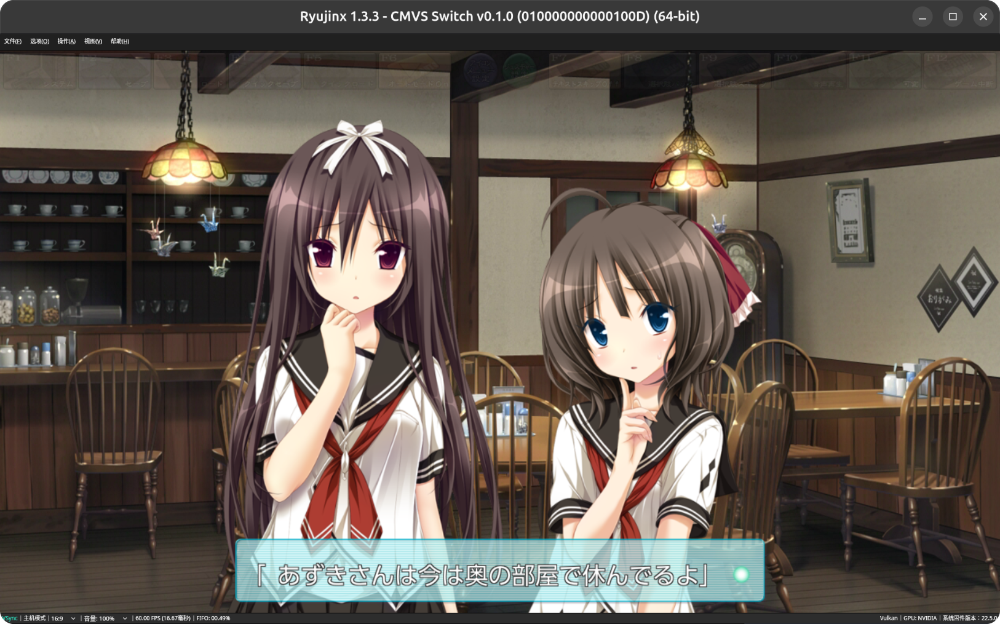
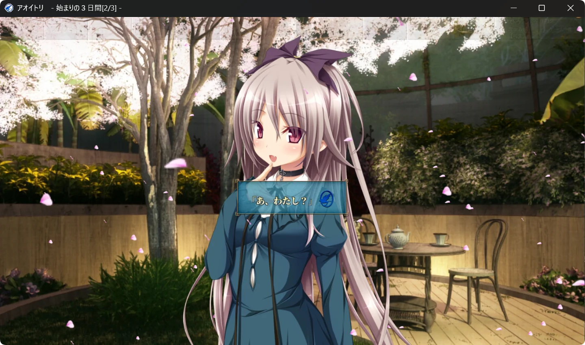
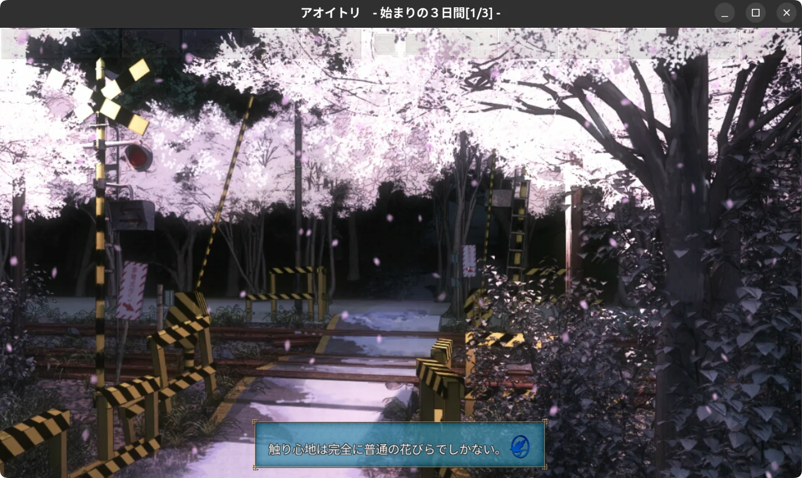
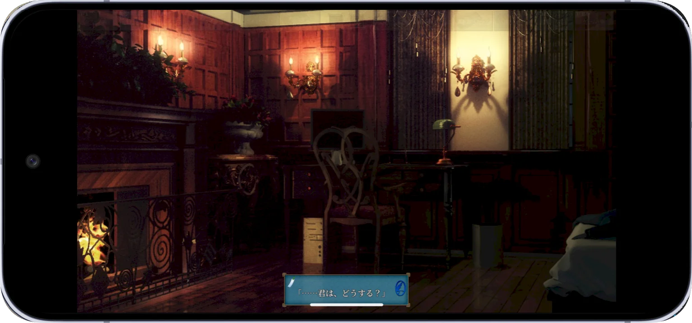
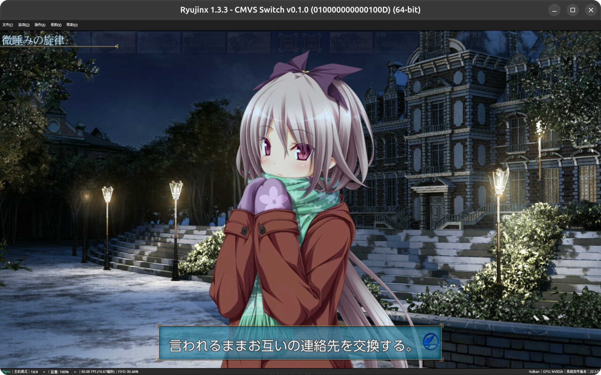

# cmvs-rs

[简体中文](README.md) | English

A **Rust** reimplementation of Purple SOFTWARE's CMVS/CVNS engine.

## Demos

<table>
  <tr>
    <th colspan="2">Akiiro Renka (CVNS)</th>
  </tr>
  <tr>
    <td align="center" width="50%">
      
    </td>
    <td align="center" width="50%">
      
    </td>
  </tr>
  <tr>
    <td align="center"><strong>Switch (Ryujinx)</strong></td>
    <td align="center"><strong>PS Vita (Vita3K)</strong></td>
  </tr>
  <tr>
    <th colspan="2">Amatsutsumi</th>
  </tr>
  <tr>
    <td align="center" width="50%">
      
    </td>
    <td align="center" width="50%">
      
    </td>
  </tr>
  <tr>
    <td align="center"><strong>Windows</strong></td>
    <td align="center"><strong>Linux</strong></td>
  </tr>
  <tr>
    <td align="center" width="50%">
      
    </td>
    <td align="center" width="50%">
      
    </td>
  </tr>
  <tr>
    <td align="center"><strong>Android</strong></td>
    <td align="center"><strong>Switch (Ryujinx)</strong></td>
  </tr>
  <tr>
    <th colspan="2">Aoitori</th>
  </tr>
  <tr>
    <td align="center" width="50%">
      
    </td>
    <td align="center" width="50%">
      
    </td>
  </tr>
  <tr>
    <td align="center"><strong>Windows</strong></td>
    <td align="center"><strong>Linux</strong></td>
  </tr>
  <tr>
    <td align="center" width="50%">
      
    </td>
    <td align="center" width="50%">
      
    </td>
  </tr>
  <tr>
    <td align="center"><strong>Android</strong></td>
    <td align="center"><strong>Switch (Ryujinx)</strong></td>
  </tr>
</table>

## Getting Started

Requires **Rust 1.90+ stable**. To play a game, see the [Running Guide](docs/guides/running.md).

Inspect a startup script and run the tests:

```bash
cargo run --bin cmvs-inspect -- "game/data/pack/start.ps3"
cargo test
```

See the [CLI Guide](docs/guides/cli.md) for more tools.

## Platforms

See [Platforms](platforms/README.md) for targets, support status, and build instructions.

## Documentation and Development

- [Documentation](docs/README.md): usage, APIs, formats, and backends.
- [Game records](docs/games/README.md): support and validation scope.
- [Architecture and checks](docs/architecture.md), [research guidelines](docs/research.md), and [references](docs/references.md).

## License

[MIT](LICENSE-MIT) OR [Apache-2.0](LICENSE-APACHE)
