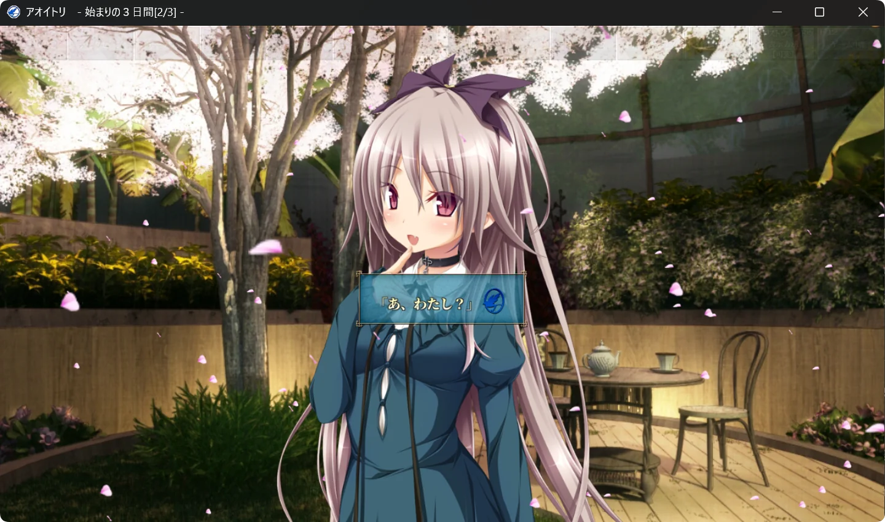
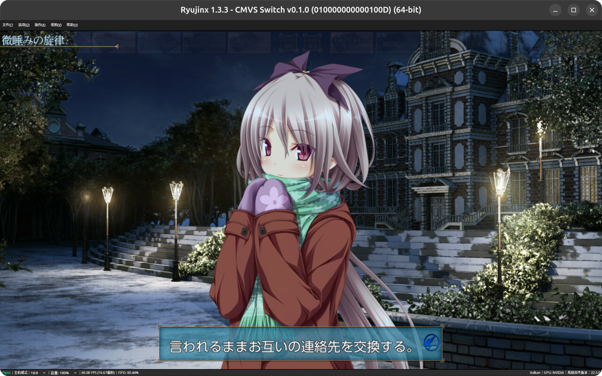

# cmvs-rs

简体中文 | [English](README.en.md)

用 **Rust** 研究并重实现 Purple SOFTWARE 的 CMVS 引擎。

## 演示

<table>
  <tr>
    <th colspan="2">Amatsutsumi</th>
  </tr>
  <tr>
    <td align="center" width="50%">
      
    </td>
    <td align="center" width="50%">
      
    </td>
  </tr>
  <tr>
    <td align="center"><strong>Windows</strong></td>
    <td align="center"><strong>Linux</strong></td>
  </tr>
  <tr>
    <td align="center" width="50%">
      
    </td>
    <td align="center" width="50%">
      
    </td>
  </tr>
  <tr>
    <td align="center"><strong>Android</strong></td>
    <td align="center"><strong>Switch (Ryujinx)</strong></td>
  </tr>
  <tr>
    <th colspan="2">Aoitori</th>
  </tr>
  <tr>
    <td align="center" width="50%">
      
    </td>
    <td align="center" width="50%">
      
    </td>
  </tr>
  <tr>
    <td align="center"><strong>Windows</strong></td>
    <td align="center"><strong>Linux</strong></td>
  </tr>
  <tr>
    <td align="center" width="50%">
      
    </td>
    <td align="center" width="50%">
      
    </td>
  </tr>
  <tr>
    <td align="center"><strong>Android</strong></td>
    <td align="center"><strong>Switch (Ryujinx)</strong></td>
  </tr>
</table>

## 开始使用

需要 Rust **1.89+ stable**。`--offline` 要求依赖已在本机缓存。

```bash
cargo run --offline -- "<游戏目录>/data/pack/start.ps3"
cargo test --offline
```

桌面预览、启动快照屏障、字体、音频和独立用户目录配置见[运行指南](docs/guides/running.md)。检查工具见[CLI 指南](docs/guides/cli.md)。

## 汉化补丁支持

请使用 [补丁转换工具](./tools/fan_patch/README.md) 自行转换汉化补丁为 cmvs-rs 标准封包，默认不提供汉化补丁支持。

## 文档与开发

- [当前状态](docs/status.md)
- [游戏档案目录](docs/games/README.md)
- [文档导航与归档规则](docs/README.md)：按用途查找资料。
- [架构](docs/architecture.md)与 [Workspace](docs/workspace.md)：模块职责、依赖和完整检查命令。
- [研究约定](docs/research.md)：证据要求及新游戏接入步骤。
- [引擎档案层](docs/design/engine-profiles.md)：按构建选择命令语义的闸门。
- [参考与许可](docs/references.md)：固定提交、第三方依赖和复用边界。

提交前运行：

```bash
cargo fmt --check
cargo test --offline
cargo clippy --offline --all-targets -- -D warnings
```

测试仅含合成数据；修改解码算法后另用仓库外真实样本与独立 Python 对照。涉及后端或 feature 时，追加 [Workspace](docs/workspace.md) 中的全功能检查。

## 许可证

[MIT](LICENSE-MIT) OR [Apache-2.0](LICENSE-APACHE) 
