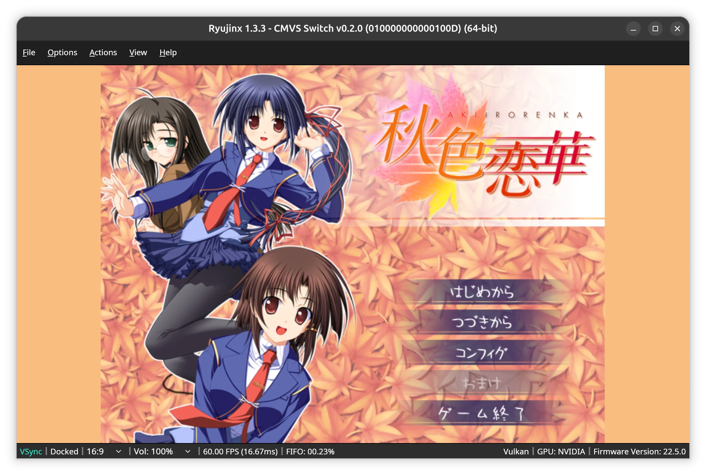
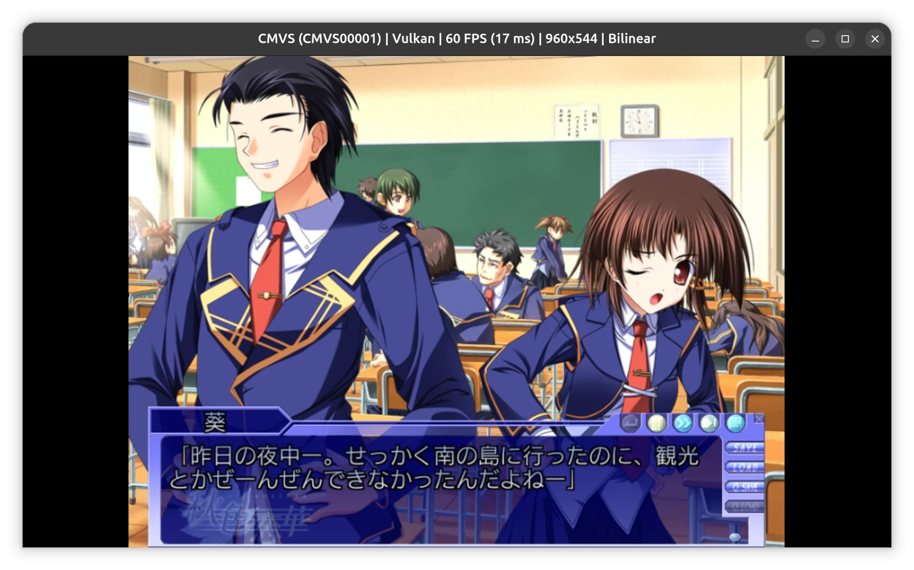
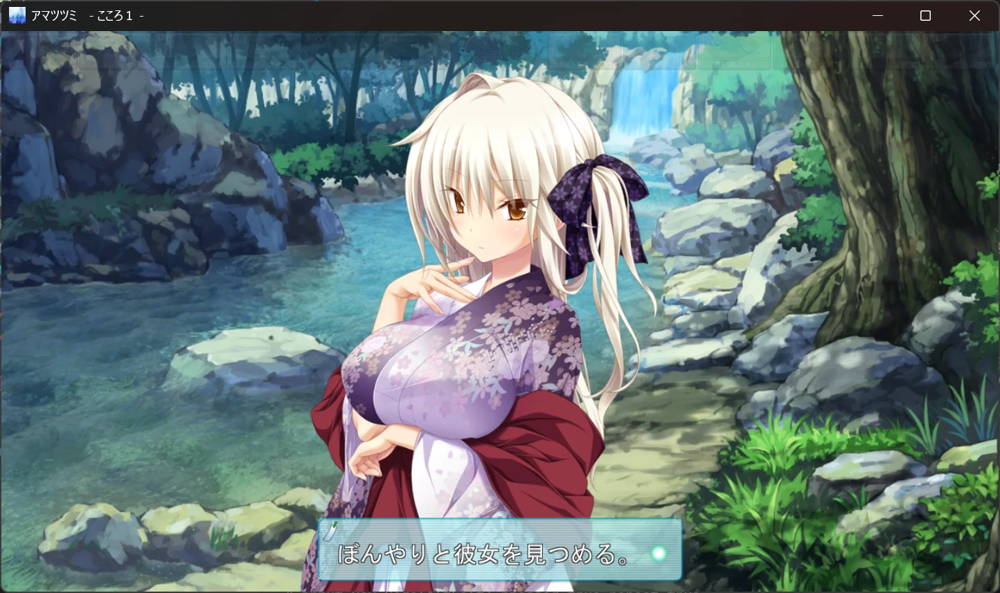
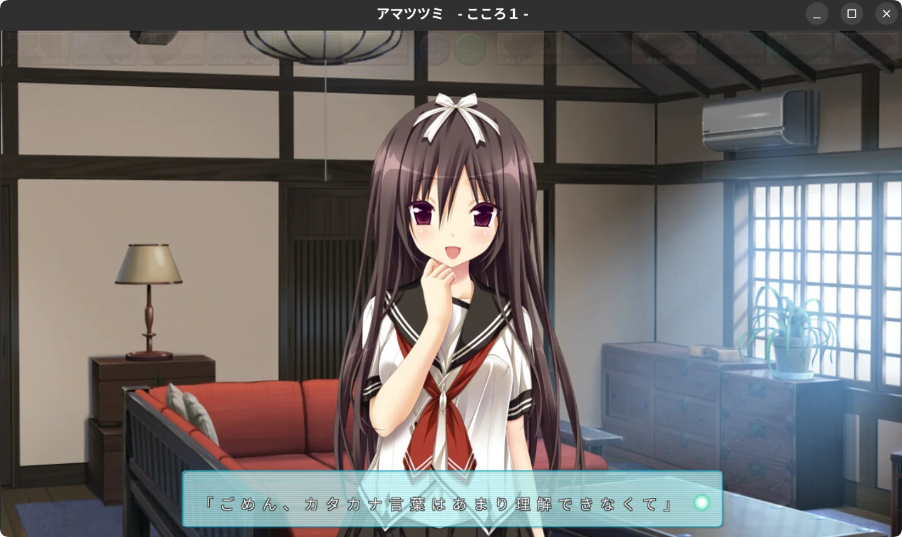
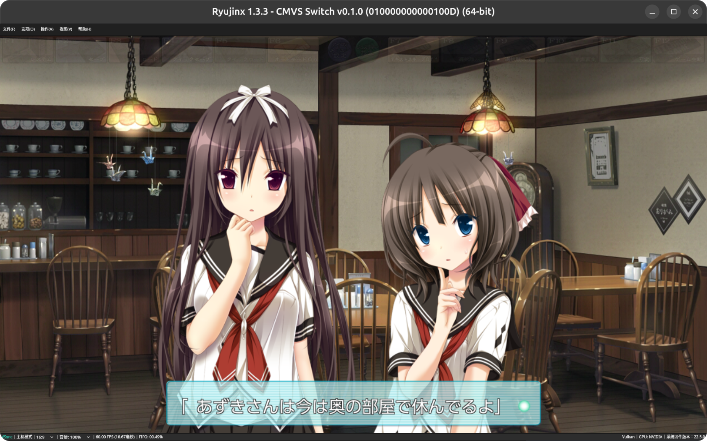
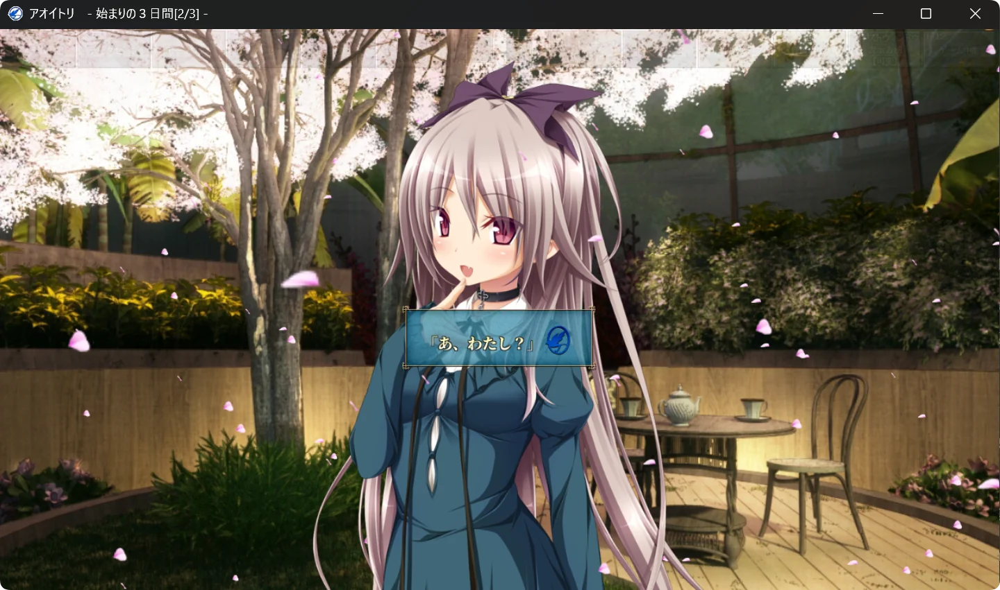
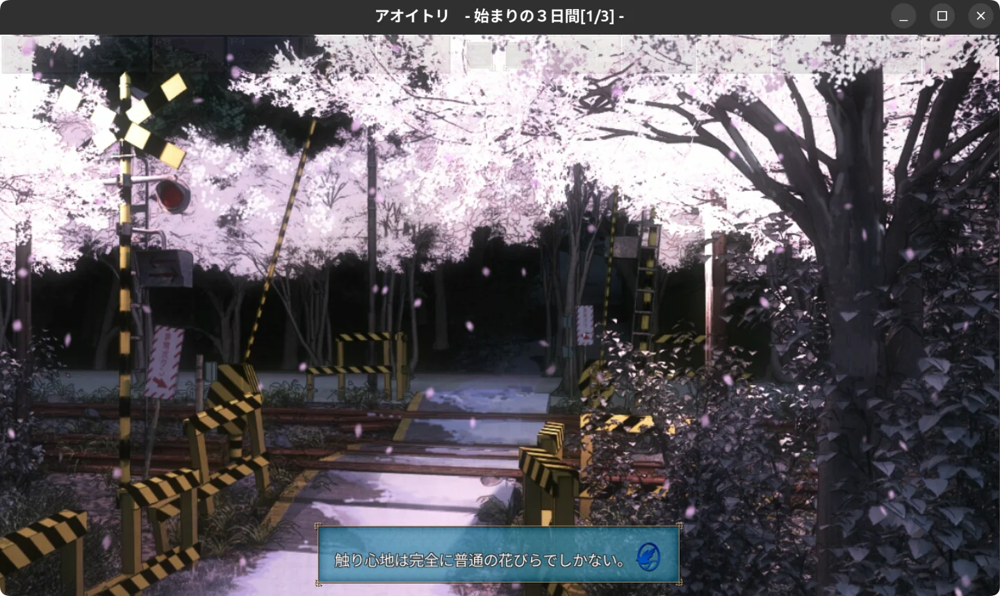
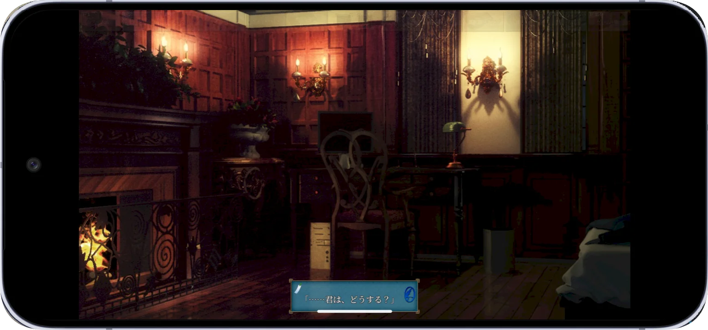
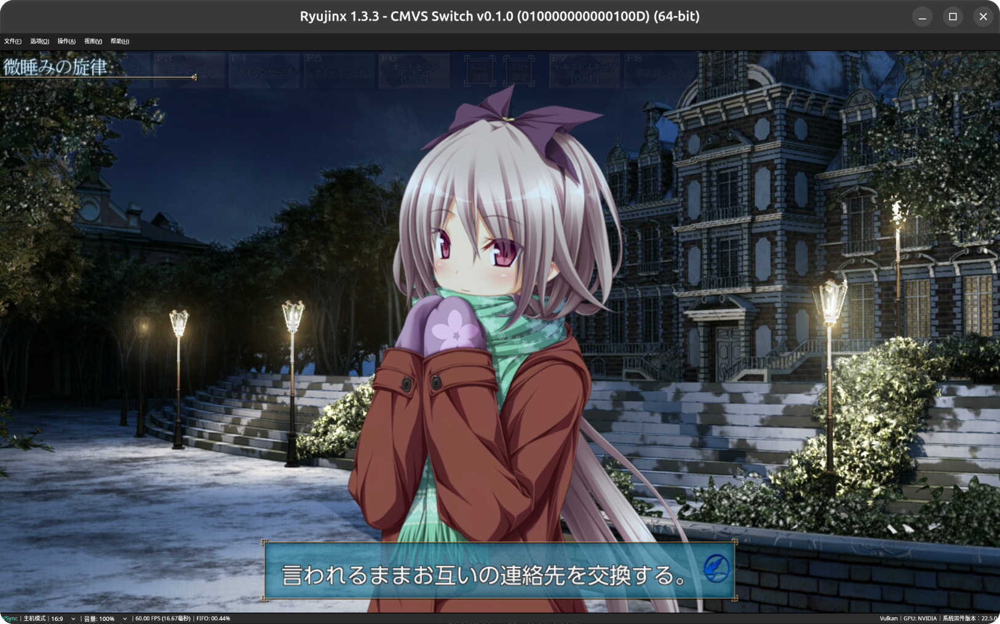

# cmvs-rs

简体中文 | [English](README.en.md)

用 **Rust** 重实现 Purple SOFTWARE 的 CMVS/CVNS 引擎。

## 演示

<table>
  <tr>
    <th colspan="2">Akiiro Renka (CVNS)</th>
  </tr>
  <tr>
    <td align="center" width="50%">
      
    </td>
    <td align="center" width="50%">
      
    </td>
  </tr>
  <tr>
    <td align="center"><strong>Switch (Ryujinx)</strong></td>
    <td align="center"><strong>PS Vita (Vita3K)</strong></td>
  </tr>
  <tr>
    <th colspan="2">Amatsutsumi</th>
  </tr>
  <tr>
    <td align="center" width="50%">
      
    </td>
    <td align="center" width="50%">
      
    </td>
  </tr>
  <tr>
    <td align="center"><strong>Windows</strong></td>
    <td align="center"><strong>Linux</strong></td>
  </tr>
  <tr>
    <td align="center" width="50%">
      
    </td>
    <td align="center" width="50%">
      
    </td>
  </tr>
  <tr>
    <td align="center"><strong>Android</strong></td>
    <td align="center"><strong>Switch (Ryujinx)</strong></td>
  </tr>
  <tr>
    <th colspan="2">Aoitori</th>
  </tr>
  <tr>
    <td align="center" width="50%">
      
    </td>
    <td align="center" width="50%">
      
    </td>
  </tr>
  <tr>
    <td align="center"><strong>Windows</strong></td>
    <td align="center"><strong>Linux</strong></td>
  </tr>
  <tr>
    <td align="center" width="50%">
      
    </td>
    <td align="center" width="50%">
      
    </td>
  </tr>
  <tr>
    <td align="center"><strong>Android</strong></td>
    <td align="center"><strong>Switch (Ryujinx)</strong></td>
  </tr>
</table>

## 开始使用

需要 Rust **1.90+ stable**。播放游戏见[运行指南](docs/guides/running.md)。

检查启动脚本和运行测试：

```bash
cargo run --bin cmvs-inspect -- "game/data/pack/start.ps3"
cargo test
```

其他工具见[CLI 指南](docs/guides/cli.md)。

## 汉化补丁支持

请使用 [补丁转换工具](./tools/fan_patch/README.md) 自行转换汉化补丁为 cmvs-rs 标准封包，默认不提供汉化补丁支持。

## 支持平台

平台目标、支持状态与构建方法见[平台总览](platforms/README.md)。

## 文档与开发

- [文档导航](docs/README.md)：使用、API、格式与后端。
- [游戏档案](docs/games/README.md)：支持范围与验证证据。
- [架构与开发检查](docs/architecture.md)、[研究约定](docs/research.md)、[参考与许可](docs/references.md)。

## 许可证

[MIT](LICENSE-MIT) OR [Apache-2.0](LICENSE-APACHE) 
