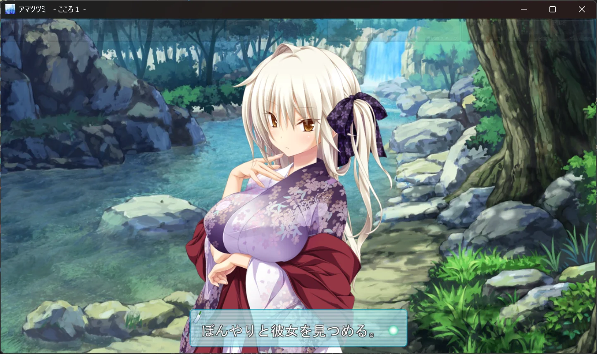
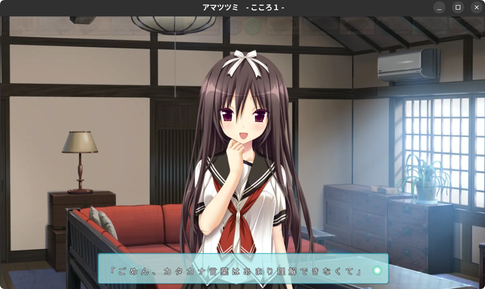
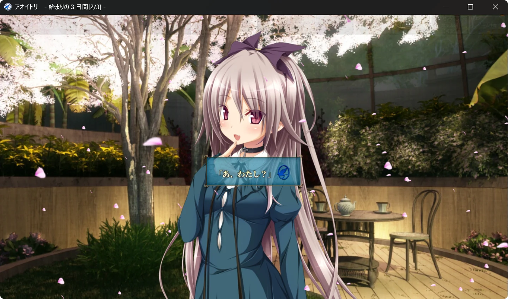
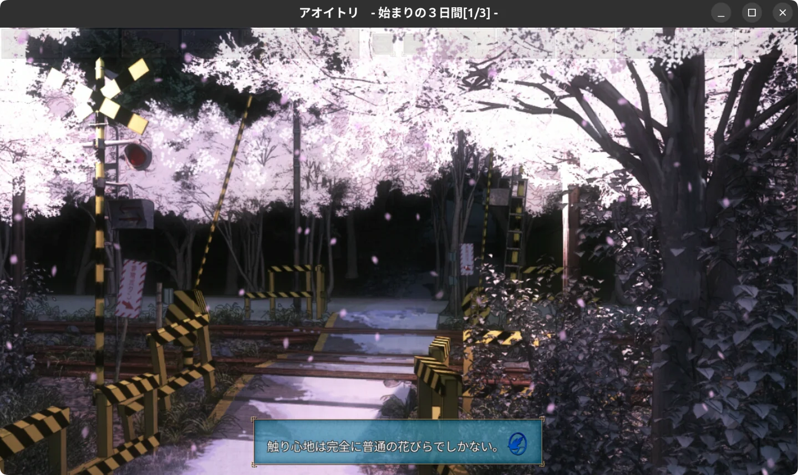

> [!WARNING]
> 项目处于开发中，尚未实现完整 CMVS 游戏兼容。

# cmvs-rs

用 **Rust** 研究并重实现 Purple SOFTWARE 的 CMVS 引擎。

## 演示

<table>
  <tr>
    <td align="center" width="50%">
      
      <br><strong>Windows</strong>
      <br><sub>Amatsutsumi</sub>
    </td>
    <td align="center" width="50%">
      
      <br><strong>Linux</strong>
      <br><sub>Amatsutsumi</sub>
    </td>
  </tr>
  <tr>
    <td align="center" width="50%">
      
      <br><strong>Windows</strong>
      <br><sub>Aoitori</sub>
    </td>
    <td align="center" width="50%">
      
      <br><strong>Linux</strong>
      <br><sub>Aoitori</sub>
    </td>
  </tr>
</table>

## 开始使用

需要 Rust **1.89+ stable**。`--offline` 要求依赖已在本机缓存。

```bash
cargo run --offline -- "<游戏目录>/data/pack/start.ps3"
cargo test --offline
```

桌面预览、启动快照屏障、字体、音频和独立用户目录配置见[运行指南](docs/guides/running.md)。检查工具见[CLI 指南](docs/guides/cli.md)。

## 当前状态

能力、游戏验证范围与主要缺口见[当前状态](docs/status.md)；全部样本见[游戏档案目录](docs/games/README.md)。

## 文档与开发

- [文档导航与归档规则](docs/README.md)：按用途查找资料。
- [架构](docs/architecture.md)与 [Workspace](docs/workspace.md)：模块职责、依赖和完整检查命令。
- [研究约定](docs/research.md)：证据要求及新游戏接入步骤。
- [引擎档案层](docs/design/engine-profiles.md)：按构建选择命令语义的闸门，以及 2007–2023 全系列普查。
- [参考与许可](docs/references.md)：固定提交、第三方依赖和复用边界。
- [开发历史](docs/games/amatsutsumi/history.md)：原 README 的阶段记录与旧停点。

提交前运行：

```bash
cargo fmt --check
cargo test --offline
cargo clippy --offline --all-targets -- -D warnings
```

测试仅含合成数据；修改解码算法后另用仓库外真实样本与独立 Python 对照。涉及后端或 feature 时，追加 [Workspace](docs/workspace.md) 中的全功能检查。

## 许可证

[MIT](LICENSE-MIT) OR [Apache-2.0](LICENSE-APACHE) 
